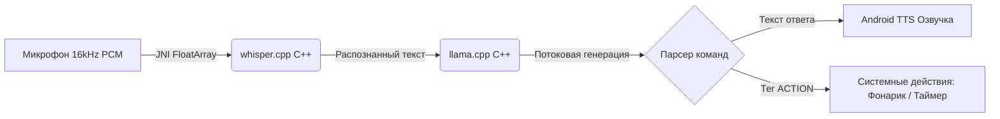

# J.A.R.V.I.S. — Offline Voice AI Assistant for Android (C++ NDK)

Автономный голосовой ИИ-помощник для Android, работающий полностью локально на устройстве без подключения к интернету и облачным API. Проект разработан с фокусом на минимальное потребление оперативной памяти и высокую производительность на мобильных ARM64-процессорах.

## Технологический стек

* **Core AI & Audio Processing:** C++17, Android NDK, CMake
* **LLM Engine:** `llama.cpp` (модель `Qwen2.5-1.5B-Instruct`, квантование `Q4_K_M`)
* **Speech-to-Text (STT):** `whisper.cpp` (модель `ggml-tiny` / `ggml-base`)
* **Bridge:** JNI (Java Native Interface) с передачей аудио-буферов без лишнего копирования
* **Frontend & System Actions:** Kotlin, Jetpack Compose, Android `AudioRecord`, `TextToSpeech`

## Архитектура конвейера (Pipeline)

## Особенности реализации
* **Zero-Cloud Privacy:** Весь аудиопоток и история диалога обрабатываются исключительно в ОЗУ смартфона.
* **Memory Footprint Optimization:** Суммарное потребление RAM при активных моделях STT и LLM не превышает **1.3 ГБ**, что позволяет запускать ассистента на устройствах среднего сегмента (4–6 ГБ ОЗУ).
* **Asynchronous Streaming:** Генерация ответа и его озвучивание происходят по мере поступления токенов без блокировки UI-потока.
